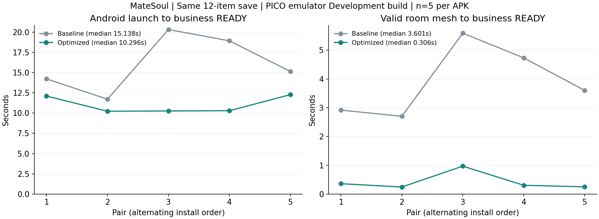

# MateSoul 冷启动优化与复测

日期：2026-10-23。平台：Unity 2022.3.38f1、PICO Unity Integration SDK、Android ARM64 / IL2CPP。本轮完成源码改动、Android Development 构建和模拟器对照复测。

**同一份 12 件物品存档下，旧包、新包各 5 次正式进程冷启动：业务就绪中位数从 15.138 秒降到 10.296 秒；网格快照完成后的等待从 3.601 秒降到 0.306 秒。10 次均完整恢复物品，且存活至 READY 后约 12 秒观察结束。**

总耗时下降约 32.0% 是本组两包的观测差异。旧包来自上一轮构建，新包还包含工作区此前的其他更新，因此不能把总差值全部归因于本次改动。阶段日志和边界检查能直接确认：锚点定位已经提前并与房间加载重叠，诊断写盘退出默认启动路径，音效绑定不再同步加载全部情绪音频。

## 1. 已完成的改动

| 改动 | 最终行为 |
|---|---|
| 存档提前读取 | `GameBootstrap` 在加载房间前读取并验证存档，交给 `GameSession` 使用，省去重复读取 |
| 锚点提前定位 | 提前发起旧锚点定位，房间加载同时进行；恢复物品时消费已有任务 |
| 事件驱动的锚点重试 | 在启动 Provider 前订阅 `SpatialAnchorDataUpdated`；空结果等待数据更新，保留约 2 秒的有界数据等待及到期查询 |
| 恢复与暂停 | 暂停及时取消恢复等待，保留尚未结束的预取任务；恢复后复用结果；定位失败继续走既有存档姿态回退 |
| 情绪音效按需加载 | `Attach` 只绑定事件，首次使用某种情绪时加载并缓存该音频池 |
| 探针按需启用 | Seating/Dialogue 探针及空间网格导出由 `MATESOUL_DEVICE_PROBES` 显式启用；默认 Development 包不启动这些探针 |
| 阶段日志与 READY | 增加存档、Provider、网格查询、导航、角色、会话、音效、物品恢复计时；暂停导致恢复未完成时不提前写 READY |
| 当前场景构建入口 | 直接打包已保存的主场景，不调用场景、角色或字体生成器；默认输出 `Builds/MateSoul_Framework.apk` |

没有修改正式角色 Prefab、动画控制器或主场景；三项文件均通过前后哈希比对。实际空间网格、遮挡和角色玩法仍保留。

音效加载成本转移到首次使用对应情绪时，并未消失；本轮没有测量首次对话音效延迟。

## 2. 对照方法

- PICO OS 6.2 模拟器，Android 16，宿主机 16 GiB 内存；两包均为 Development。
- 两包各预热一次，预热结果保留但不纳入正式统计。
- 正式执行 5 对冷启动，安装顺序为 AB、BA、AB、BA、AB。每次先停止应用、确认进程消失，恢复同一份存档和偏好，再执行 `am start -W`。
- 计时使用设备单调时钟日志中的 Activity START、网格快照和业务 READY；约每秒读取进程 `smaps_rollup`。
- 每轮核对物品数量、恢复状态及存档实例 ID / 定义集合。READY 后继续观察约 12 秒。
- 本轮没有清空应用缓存、重启设备或进行首次安装授权测试；也没有执行交互循环泄漏测试。

启动前使用的存档 SHA-256：

`3663b55afeeb2613ce38e27413a908b7ac2a8662b2e5c2464e7a3648f7d4f3c5`

## 3. 冷启动结果

| 对照对 | 旧包 READY，秒 | 新包 READY，秒 | 旧包网格后等待，秒 | 新包网格后等待，秒 |
|---|---:|---:|---:|---:|
| 1 | 14.221 | 12.102 | 2.916 | 0.362 |
| 2 | 11.715 | 10.231 | 2.702 | 0.246 |
| 3 | 20.315 | 10.260 | 5.590 | 0.971 |
| 4 | 18.920 | 10.296 | 4.730 | 0.306 |
| 5 | 15.138 | 12.277 | 3.601 | 0.253 |
| **中位数** | **15.138** | **10.296** | **3.601** | **0.306** |

- 业务 READY 的组中位数差为 **4.842 秒，约 32.0%**。
- 网格后等待的组中位数差为 **3.295 秒，约 91.5%**。
- Android Activity 初始显示中位数分别为 **922 / 710 ms**，仍明显早于游戏业务就绪。
- 正式 10 次及两次预热都恢复了 **12 件物品、`itemState=ready`**，实例身份集合保持一致。
- 正式 10 次均存活至短暂观察结束；本窗口未复现前一轮的 READY 后异常退出。这不能代替长稳及真机验证。

本轮旧包中位数与上一轮 11.465 秒不同，不能混为一组。测试批次、宿主调度、存档姿态及包内既有代码更新都有差异；样本量仅为每包 5 次，不汇报插值 P95。

## 4. 优化是否真的生效

### 锚点定位与房间加载发生重叠

新包各轮在 Bootstrap 开始后约几毫秒发起锚点定位，接着立即进入房间加载。锚点未找到时约 2 秒结束等待；物品恢复使用该任务的失败结果，继续通过存档中已经验证的房间姿态恢复。

正式各轮旧包均有 **6 次空锚点查询**；新包均为 **3 次查询、1 次原生数据更新事件**。该事件返回的仍是空数据，因此新流程保持到期查询，没有把一次空结果当成永久失效，也没有删除存档锚点或物品。

新包第 3 轮房间加载仅约 1.099 秒，早于锚点等待完成，网格后的等待相应为 0.971 秒；其他轮次房间加载覆盖了锚点等待的大部分或全部时间。这与并行流程相符，而非跳过存档恢复。

本轮验证了空数据更新事件和旧锚点缺失路径。真机上的有效 UUID、重定位成功及非空数据更新仍需验收。

### 默认启动不再写探针文件

对比每轮前后 Seating 网格、Seating 状态和 Dialogue 结果文件的时间戳及大小：旧包 **5/5** 检测到更新，新包 **0/5**。已有探针文件没有被当成加速缓存，也没有据此清除用户数据。

### 音效绑定没有同步资源加载

新包的 `session_created` 与 `audio_bound` 阶段中位时刻相同，均为 Bootstrap 后 3355 ms。源码中的 `Attach` 已移除四次 `Resources.LoadAll`；音频播放与池选择由既有 Unity 回归检查验证。

## 5. 剩余的主要等待

| 新包阶段 | 中位数 | 范围 | 能确认的含义 |
|---|---:|---:|---|
| Activity START → Bootstrap.Start | 7.768 s | 5.728–8.193 s | 业务脚本开始前仍有较大等待 |
| Unity engine 初始化标记 → Bootstrap.Start | **4.859 s** | 4.853–5.127 s | 下一步优先分解 Unity 场景/资源与 XR 初始化 |
| Bootstrap.Start → 房间加载完成 | **3.215 s** | 1.099–6.015 s | XR 网格子系统很快可用，但有效网格需要多次查询 |
| 房间加载完成 → READY | **0.303 s** | 0.243–0.967 s | 本轮优化已经显著压缩这一段 |

各阶段中位数来自不同轮次，不能直接相加当作总中位数。

网格子系统可用的阶段中位时刻为 Bootstrap 后约 13 ms，启动约 24 ms。有效网格查询仍按约 500 ms 间隔重试，部分轮次需要更多查询。当前证据指向“有效空间数据到达的等待”，并不支持把整个区间归为 NavMesh 成本。

下一步应优先：

1. 在目标头显用 Release 包复测有效锚点与缺失锚点两条路径，确认本次并行初始化的行为和真实启动收益。
2. 用 Unity Profiler 的加载与 CPU 时间线拆分约 4.86 秒的引擎到 Bootstrap 区间；同时采集 Memory Profiler 快照定位常驻资源。
3. 对照原生空间数据更新与首次有效网格返回，确认网格等待来自设备扫描、Provider 就绪还是应用轮询，再决定是否调整轮询机制。

`first_main_camera_render` 的新包阶段中位数为 Bootstrap 后约 37 ms。它是 Unity `endCameraRendering` 回调，**不能作为 XR Compositor 实际显示首帧的证据**。

## 6. 内存与包体旁证

| 指标 | 旧包 | 新包 |
|---|---:|---:|
| 每轮最后 5 个样本 PSS 中位数，再取组中位数 | 1019.43 MiB | 920.14 MiB |
| 正式轮次全局采样 PSS 峰值 | 1340.71 MiB | 1371.12 MiB |
| 稳定尾部 SwapPss 组中位数 | 0 MiB | 0 MiB |
| APK 实际文件大小 | 174.41 MiB | 192.81 MiB |
| ZIP 条目压缩载荷合计 | 174.16 MiB | 174.24 MiB |
| APK 总大小减压缩载荷 | 0.25 MiB | 18.57 MiB |

新包的短暂稳定尾部 PSS 较低，启动全局采样峰值并未降低。两包还有其他代码差异，且没有 Unity 对象快照，本轮不把内存变化单独归因于音频或探针，也不判定已经消除泄漏。

包体差值主要体现为容器开销，压缩载荷仅增加约 0.08 MiB；不能据 APK 文件增长推断场景内容或运行内存同幅增长。两包均未新增 ZIP 条目，1444 个条目的载荷 CRC / 长度一致，118 个条目变化，详情见数据目录。

## 7. 构建、回归与恢复

- Unity 完成 Android 构建并输出 `MATESOUL_BUILD_PASS`；APK ZIP CRC 和 ARM64 IL2CPP 库检查通过。
- **9/9 Unity 回归检查通过**：覆盖存档恢复、缺失锚点回退、暂停恢复、待恢复动作准入、晚完成/存储失败清理及情绪音效。
- **8 条预取锚点边界断言通过**：直接针对已编译的 `GameSession` 程序集验证完成任务复用、等待、及时取消、暂停保留任务、恢复复用、失败传播、失败清理及再次查询。它们是独立边界检查，不计为新增 NUnit 用例。
- 工具结束时报告 Unity 全局遥测 / SDK 元数据写入受到沙箱限制；实际 Unity 子进程退出为 0，结果 XML、构建成功标记及 APK 均已独立复核。
- 存档和两个偏好文件已恢复。最终存档哈希与启动前备份完全相同，仍为 12 件物品；测试辅助文件已删除。
- 安装包哈希已与新 APK 对比一致；ADB 恢复到 `uid=2000(shell)`，模拟器进程退出已确认。
- 正式角色 Prefab、动画控制器、主场景前后哈希相同。

默认启动脚本继续使用 `Builds/MateSoul_Framework.apk`，该文件已经更新为验证过的新包。旧包保留为 `Builds/MateSoul_Framework_Baseline_20261022.apk`。

新包 SHA-256：

`86a9d240f933d60f7df47aa548eed310692663d11f09fe4def3e3471b56a9892`

后续构建应使用 `MateSoul/Game/Build Current Scene Android Development APK` 或对应 Release 入口。原来的 `Build Android` 入口仍会调用场景生成器。

## 8. 可复核交付

- [默认新 APK](computer:///Users/bytedance/MateSoul/Builds/MateSoul_Framework.apk)
- [旧包对照备份](computer:///Users/bytedance/MateSoul/Builds/MateSoul_Framework_Baseline_20261022.apk)
- [统计汇总](computer:///Users/bytedance/MateSoul/项目沉淀资料/性能测试/20261023-startup-optimization/summary.json)
- [12 次启动 CSV，含两次预热](computer:///Users/bytedance/MateSoul/项目沉淀资料/性能测试/20261023-startup-optimization/startup_results.csv)
- [原始测量及阶段时刻](computer:///Users/bytedance/MateSoul/项目沉淀资料/性能测试/20261023-startup-optimization/measurements.json)
- [内存采样 CSV](computer:///Users/bytedance/MateSoul/项目沉淀资料/性能测试/20261023-startup-optimization/memory_samples.csv)
- [精简启动证据](computer:///Users/bytedance/MateSoul/项目沉淀资料/性能测试/20261023-startup-optimization/startup-evidence.log)
- [回归结果 XML](computer:///Users/bytedance/MateSoul/项目沉淀资料/性能测试/20261023-startup-optimization/regression-results.xml)
- [预取边界检查](computer:///Users/bytedance/MateSoul/项目沉淀资料/性能测试/20261023-startup-optimization/prepared-anchor-checks.txt)
- [恢复与资产校验记录](computer:///Users/bytedance/MateSoul/项目沉淀资料/性能测试/20261023-startup-optimization/restoration.json)

关键源码：[启动组装与 READY](file:///Users/bytedance/MateSoul/MateSoul/Assets/MateSoul/Runtime/GameBootstrap.cs#L81-L250)、[预取任务消费](file:///Users/bytedance/MateSoul/MateSoul/Assets/MateSoul/Runtime/GameSession.cs#L625-L710)、[锚点事件与有界等待](file:///Users/bytedance/MateSoul/MateSoul/Assets/MateSoul/Runtime/SpatialAnchorService.cs#L65-L143)、[音效懒加载](file:///Users/bytedance/MateSoul/MateSoul/Assets/MateSoul/Runtime/ResponseEmotionAudio.cs#L25-L39)、[当前场景构建](file:///Users/bytedance/MateSoul/MateSoul/Assets/MateSoul/Editor/GameSceneBuilder.cs#L1642-L1677)。

## 9. 相邻计时点的具体耗时归因

以下仅使用 5 次正式新包冷启动。每轮先减去相邻计时点，再对区间耗时取中位数；
不使用两个累计时间中位数相减，也不将不同阶段的中位数相加。

### 9.1 串行阶段

| 阶段 | 中位数 | 最小–最大 | 测量边界 |
|---|---:|---:|---|
| Activity START → 引擎标记 | 2.909s | 0.601–3.276s | Android/原生启动，尚未进一步分解 |
| 引擎标记 → Bootstrap.Start | 4.859s | 4.853–5.127s | 含 XR 会话、引擎、启动画面和场景进入生命周期的区间 |
| Bootstrap.Start → 房间加载开始 | 12ms | 8–27ms | 遮挡组件安装、通知初始化、存档验证、发起锚点任务等前置工作 |
| 房间加载开始 → 完成 | 3.203s | 1.085–5.988s | 网格子系统启动、反复查询、快照构建与验证 |
| 应用遮挡快照 | 6ms | 5–13ms | `room_loaded → occlusion_applied` |
| NavMesh 构建 | 31ms | 28–35ms | `occlusion_applied → navmesh_built` |
| 角色定位与绑定 | 6ms | 5–9ms | 出生点采样、激活、Motor/Idle/SocialAttention 绑定；不含先前的模型资源载入 |
| 会话组装 | 80ms | 76–99ms | 物品根、LLM Provider、人格解析、GameSession/动作目录及初始上下文 |
| 音效绑定 | 1ms | 0–2ms | 仅事件绑定，不是实际音频文件加载 |
| 世界配置 | 123ms | 117–181ms | 社交/牵手、现实网格与椅床扫描器、小游戏及 AI 世界上下文初始化 |
| 物品恢复，不含残余锚点等待 | 11ms | 9–18ms | 姿态回退、12 件物品生成与恢复等剩余处理 |

Bootstrap 到存档就绪的单独区间为 6ms（4–16ms），其中还包含前面的遮挡组件与
通知初始化，不能将它命名为纯文件读取成本。世界配置中的各子项尚未分别计时。
毫秒日志出现 0ms 表示该区间未跨越日志时钟的整毫秒，不代表操作没有成本。

第 4 轮总耗时恰好对应组中位数，采用设备单调日志可以精确拼接：

**1.923s Android/引擎前启动 + 4.853s 引擎到业务 Start + 0.013s 前置 +
3.203s 房间网格 + 0.304s 房间加载后收尾 = 10.296s。**

该轮对应总时间占比约为 18.7%、47.1%、0.1%、31.1%、3.0%。

### 9.2 网格阶段的查询与等待

| 轮次 | 网格查询次数 | SDK 调用累计历时 | 相邻查询间隔累计 | 最终快照构建/验证 |
|---|---:|---:|---:|---:|
| 1 | 12 | 343ms | 5597ms | 14ms |
| 2 | 5 | 75ms | 2059ms | 10ms |
| 3 | 3 | 39ms | 1018ms | 9ms |
| 4 | 7 | 109ms | 3068ms | 12ms |
| 5 | 9 | 140ms | 4089ms | 9ms |

第 4 轮网格阶段 3203ms 中，3068ms 落在相邻查询间隔，占约 **95.8%**。
7 次异步 SDK 调用累计仅 109ms，最终快照构建/验证 12ms，其余为启动、返回等边界。

源码在前次查询未得到有效快照后执行 `Task.Delay(500)`，再经 Unity 主线程恢复继续
查询。第 4 轮 6 个间隔的名义延时为 3000ms，实测 3068ms，约 68ms 是超出名义
睡眠的调度/恢复间隔。SDK 调用的历时也含异步等待，不能当成纯 CPU 计算成本。

因此该段主要表现为等待有效空间网格，不是网格几何计算耗费几秒。计时点没有记录
每次查询的原生结果和网格数量，无法把早期失败继续拆为空数据与错误返回。
降低轮询间隔可能减少末次发现有效数据的延迟，不能据此承诺消除全部 3 秒等待。

### 9.3 锚点等待的并行贡献

| 轮次 | 锚点任务总历时 | 恢复物品时还需等待 |
|---|---:|---:|
| 1 | 2095ms | 0ms |
| 2 | 2048ms | 0ms |
| 3 | 2048ms | 710ms |
| 4 | 2046ms | 0ms |
| 5 | 2044ms | 0ms |

4/5 轮的锚点等待被房间加载覆盖。第 3 轮网格仅花 1085ms，恢复物品在 Bootstrap
后 1345ms 开始，锚点到 2055ms 才结束，故物品恢复区间为 721ms，其中 710ms 是
锚点等待、余下 11ms 为恢复处理。不能把 721ms 都归为物品实例化。

旧包的 5×400ms 固定等待是可确认的串行成本。网格后中位差 3.295s 还包含其他
处理和调度变化；旧包没有相同的全部分项打点，也没有音效/探针的单变量对照，
因此目前不能给音效、探针分别分配精确的节省秒数。

### 9.4 引擎到业务 Start 之前的 SDK 时间边界

从现有原生日志提取 XR 会话状态和场景中的 PXR_Manager 版本日志，可进一步定位：

| 相邻边界 | 中位数 | 最小–最大 |
|---|---:|---:|
| 引擎标记 → XR 会话 FOCUSED | 2357ms | 2171–2621ms |
| XR FOCUSED → PXR_Manager 的 Awake 内版本日志 | 2372ms | 2082–2513ms |
| 该版本日志 → Bootstrap.Start | 188ms | 168–257ms |

第 4 轮对应 **2171 + 2507 + 175 = 4853ms**，与引擎到 Bootstrap 的区间一致。
第 4 轮 XR FOCUSED 后 2486ms 出现 PhysX 初始化日志，随后进入
PXR_Manager.Awake。这说明大的等待在普通业务 Start 之前。

这些是生命周期的墙钟边界，不等于 XR CPU 成本、模型读取成本或 PXR_Manager
函数执行成本。项目当前启用了 Unity Splash Screen 和 Unity Logo，计时尚未记录
启动画面结束、SceneLoaded、模型/贴图加载与 Shader 编译，因此不能把约 4.86 秒
全部归因于某一个资源或某一个 SDK 调用。

后续应优先补齐 BeforeSceneLoad/AfterSceneLoad、启动画面结束和 Profiler 加载时间线，
再按实际证据优化这一段；NavMesh、角色绑定与物品生成目前均非秒级瓶颈。

分项数据：[CSV](computer:///Users/bytedance/MateSoul/项目沉淀资料/性能测试/20261023-startup-optimization/startup-attribution.csv)、
[JSON](computer:///Users/bytedance/MateSoul/项目沉淀资料/性能测试/20261023-startup-optimization/startup-attribution.json)。
前置生命周期证据：[SDK 日志摘录](computer:///Users/bytedance/MateSoul/项目沉淀资料/性能测试/20261023-startup-optimization/pre-bootstrap-sdk-evidence.log)。
轮询依据：[RoomMapProviders](file:///Users/bytedance/MateSoul/MateSoul/Assets/MateSoul/RoomNavigation/Runtime/RoomMapProviders.cs#L305-L341)。
启动画面配置：[ProjectSettings](file:///Users/bytedance/MateSoul/MateSoul/ProjectSettings/ProjectSettings.asset#L19-L27)。

## 10. 2026-10-24：前置生命周期实测与 Profiler 归因

本阶段完成 1 次预热、5 次正式冷启动及 1 次独立二进制 Profiler 录制。
7 次均恢复同一份 12 件物品存档，身份保持，READY 后存活 12 秒。
Profiler 录制不混入正式统计。本组计时包 READY 中位数为 13.064s，
引擎到 Bootstrap 为 5.030s；本阶段没有总耗时的单变量优化对照，
不能把不同测试组的差值当作改善或退化的因果证据。

### 10.1 新增观测边界

`StartupTimeline` 在 `BeforeSplashScreen` 建立单调时钟，新增：

- `before_splash_screen`、`before_scene_load`、`scene_loaded`、
  `after_scene_load` 和 `bootstrap_awake`。
- `first_player_loop`、`first_before_render_callback` 以及启动画面状态观测。
- `hud_start → hud_font_load_start → hud_font_load_end → hud_ready`。
- `avatar_enable_start → avatar_enable_end`，用于区分激活生命周期与后续绑定。
- 原有 Bootstrap 阶段同时输出同一时钟的 `MATESOUL_TIMELINE`。

全部 Unity API 保持在主线程。启动画面只在观察到未结束状态后，才记录首次结束
状态及上次未结束的时刻；两者构成观测区间。若主线程回调首次执行时画面已经结束，
只能利用生命周期日志给出边界，不能冒称记录到了画面真正结束的瞬间。
`BeforeSplashScreen` 也不等于画面实际开始显示。

独立 Profiler 采样通过 Development 包外部数据目录下的
`startup-profile.enabled` 文件开启，输出 `startup-profile.raw`；
业务 READY 后两帧或 30 秒时停止录制，启动观测回调在 READY 后清理，
退出应用时亦清理。常规计时不启用二进制录制，Release 不执行这些观测。
`StartupProfileExport` 可由 Unity 批处理导出帧、线程、样本名称及包含子项的历时。
嵌套样本不能直接相加；导出保留前四帧全部样本，后续保留至少 1ms 的样本。

### 10.2 已验证与交付

- Android Development ARM64 / IL2CPP 构建成功，APK ZIP CRC 校验通过。
- Editor 再次编译成功，包含 `StartupProfileExport`，没有 C# 编译错误。
- 主场景、角色 Prefab、动画控制器及项目设置前后哈希一致。
- 当前 Unity 构建日志为 `Pro License: NO`；未修改启动画面或 Logo 设置。
- 本节基线测试结束时，默认 APK 恢复为上一轮验证包，SHA-256 为
  `86a9d240f933d60f7df47aa548eed310692663d11f09fe4def3e3471b56a9892`；
  后续已更新为第 10.5 节通过复测的重叠版本。
- 独立计时包：
  [MateSoul_StartupTimeline_20261024.apk](file:///Users/bytedance/MateSoul/Builds/MateSoul_StartupTimeline_20261024.apk)，
  214636370 bytes，SHA-256：
  `5042d715237c6a02db5e5c8f035d4483f6bd62018f5971934d7fefccb26b07cf`。

### 10.3 相邻边界的正式实测

每轮先减去相邻设备单调时刻，再取区间中位数，不相加不同区间的中位数。

| 边界 | 中位数 | 最小–最大 |
|---|---:|---:|
| 引擎标记 → BeforeSplashScreen | 293ms | 269–330ms |
| BeforeSplashScreen → XR FOCUSED | 2189ms | 1948–2801ms |
| XR FOCUSED → BeforeSceneLoad | 2356ms | 1749–2601ms |
| BeforeSceneLoad → AfterSceneLoad | 55ms | 37–95ms |
| AfterSceneLoad → Bootstrap.Start | 127ms | 122–242ms |
| HUD.Start → HUD 完成 | 124ms | 118–232ms |
| HUD 字体实际加载 | 92ms | 89–121ms |
| 角色激活生命周期 | 6ms | 4–8ms |

第 4 轮对应总 READY 中位数，完整区间可拼接：

**3.587s Android/引擎前 + 0.269s 引擎到启动画面前 + 1.979s 到 XR 焦点 +
2.561s 到场景回调前 + 0.037s 场景生命周期 + 0.127s 到 Bootstrap +
4.504s Bootstrap 后 = 13.064s。**

这些是墙钟边界，前两段含资源载入和渲染准备，第三段也不能直接命名为
“模型加载耗时”。5 轮均为 HUD 完成后才进入 Bootstrap.Start，
字体及 HUD 构建因此阻止了异步房间读取提前开始。

### 10.4 独立 Profiler 证据

原始录制 69121751 bytes；完整导出帧范围 **0–404**。
Unity 默认导入只保留最后 300 帧，首次导出得到 105–404，
已通过本次批处理进程的原生历史容量设置提高到 2000 帧后重新导出完整数据；
没有修改用户 EditorPrefs。部分原生样本无元数据描述，
导出保留其名称与历时，不猜测对应资产名称。

| 样本 | 单次录制历时 | 解释 |
|---|---:|---|
| 首个长主线程帧 | 2568.107ms | 帧 1，包含资源、着色器和渲染准备 |
| 后台 Application.Preload Assets / LoadSceneOperation | 1760.316ms | 与主线程等锁区间重叠，不能再加到主线程耗时上 |
| 主线程 Loading.LockPersistentManager | 1526.859ms | CustomRenderTextures.Update → Loading.ReadObject 内的资源管理锁等待 |
| WatermarkRender 下 Shader.CreateGPUProgram | 708.156ms | 其中 Semaphore.WaitForSignal 为 708.113ms；是 GPU 程序准备等待，不能计作角色 Shader CPU 耗时 |
| HUD.Start 的 Profiler 调用范围 | 129.233ms | 与常规计时的 HUD / 字体区间相符 |

该首帧中，资源管理锁与水印着色器等待互不重叠，合计约 2234.972ms，
占首帧墙钟约 **87.0%**。因此到 XR FOCUSED 的墙钟不能全部归因于 XR 代码执行。
后台预加载还出现多个 AsyncReadManager.SyncRequest 等待，尚未映射到具体 FBX
或贴图，不能把资源管理锁按猜测分配给角色或物品。

该录制 XR FOCUSED（368.271s）到 BeforeSceneLoad（370.227s）的 1956ms 中，
98 个 `EarlyUpdate.XRUpdate` 样本与该区间相交，包含子项的历时累计 1526.604ms。
这些原生叶样本尚未区分 CPU 与帧节奏等待，不能当成 1.53 秒纯计算；
本段在已导出的至少 1ms 主线程样本中未出现新的资源锁或 GPUProgram 创建。
需要真机或原生 CPU 采样后才能评价手机级芯片上的实际成本。

### 10.5 已完成：房间读取与 UI 初始化重叠

最终版本完成预热 1 次、正式冷启动 3 次，以及独立 Profiler 1 次。
5 次均恢复同一份 12 件物品存档，保持物品身份，READY 后存活 12 秒。
预热及 3 次正式运行逐轮核验：`room_load_start` 先于 HUD 和系统通知初始化；
`navmesh_built → item_restore_start → items_restored → business_ready` 顺序保持。
Profiler 不混入正式统计。

实现：

- `GameBootstrap.cs.meta` 的 `executionOrder` 设为 `-100`，其 Start 先发起房间请求。
  使用 Unity 自带的脚本导入设置作为唯一顺序声明。
- `SystemNotificationPresenter.Bind` 只接入通知数据，字体和 UI 创建移至该组件的
  Start。原 Bind 同步读取共享字体；若只提前 Bootstrap，会把字体等待搬到房间请求前。
  已产生的通知由 Start 中的 Refresh 显示。
- 当前场景 Development 构建入口加入 `BuildOptions.CleanBuildCache`。
  仍只构建保存的场景，不执行角色、动画或场景的资产生成器。

**构建缓存证据：** 两次增量包虽然分别包含代码属性或本地 `executionOrder=-100`，
但 APK 中 `GameBootstrap` 的 `MonoScript.m_ExecutionOrder` 都仍为 **0**，
运行日志也均是 HUD 在前。旧包与该增量包的合并
`globalgamemanagers.assets` SHA-256 均为
`71c53d3a427b55e283544ab554cf850fd339a42508b233b5a3ce077dc2271ed9`。
干净构建写入 **-100**，该资源哈希变为
`92cc76b15b684331671dc4539efefa7f7d6432e800666046aa3f5a05294d5155`；
最终 APK 解析与运行顺序都验证通过。不能仅以 C# 编译成功或 APK 整体哈希变化
认定顺序设置已进入 Player。

以下两组托管边界均先使用同一个 `sinceBeforeSplashMs` Stopwatch 作差，再取中位数：

| 指标 | 基线 5 轮中位数 | 最终 3 轮中位数 | 最终最小–最大 |
|---|---:|---:|---:|
| AfterSceneLoad → 发起房间读取 | 138ms | **53ms** | 33–54ms |
| HUD 总历时 | 124ms | 338ms | 333–420ms |
| HUD 字体加载 | 92ms | 269ms | 259–318ms |
| 系统通知 UI 初始化 | 无独立边界 | 1ms | 1–4ms |
| 两类 UI 落在房间等待区间内的历时 | 0ms | 339ms | 337–421ms |

已确认的改善是**房间请求前的串行等待减少 85ms**。字体和 HUD 自身耗时没有
被消除，当前正式组的数值反而更高，但它们已在请求发起后的房间等待区间内执行。
最终组 READY 为 **11.709s**（11.495–12.626s）；基线组为 13.064s。
两组还跨越干净构建和运行环境波动，不能把总差值 1.355s 当成该修改的因果收益。
本轮也不证明首次 UI 显示或真机首帧已加快。

为核对较高的 UI 数值，追加了一次独立录制，完整导出 **0–456** 帧，
原始文件 71639740 bytes：

- HUD Start 样本为 **134.131ms**，内部 `Loading.ReadObject` 为 **93.184ms**。
- 三个互不重叠的 `File.Read` 为 35.918、32.569、22.893ms，合计 **91.380ms**。
  `ReadObjectThreaded`、`AsyncReadManager.SyncRequest` 等为包含这些读操作的嵌套样本，
  不再重复相加；文件读墙钟亦不能当作纯 CPU 成本。
- 同次托管字体边界为 102ms，未重现正式组的 269ms 中位数。
  单次录制只能确认该次以读取等待为主，尚不能解释全部正式轮次差异，
  不把较高值认定为固定计算开销或已证实的持续退化。

**UI 回归状态：** 现有 `BottomHudExpandsVerticalInteractionActivities` 已通过通知
数量、先后顺序和进入透明度断言，随后在 `GameRuntimeTests.cs:2435` 的通用 Graphic
材质断言失败。切回旧同步 Bind 作对照，同样在该行失败；之后恢复最终源码并核验
与构建时副本完全一致。该测试整体仍是失败，不能记为通过；TMP 子网格与该材质断言
的适配需独立处理。

Android ARM64 / IL2CPP、ZIP CRC、包内执行顺序和四项保护资产哈希均通过。
最终默认及设备安装包 SHA-256 一致：
`08ba06dcba77c678e398da6e5fad91d4f3c0be63094a447b2c08de4d76103f69`。
APK 大小为 **182999478 bytes**：
[MateSoul_StartupOverlap_20261024.apk](file:///Users/bytedance/MateSoul/Builds/MateSoul_StartupOverlap_20261024.apk)。
默认入口为 [MateSoul_Framework.apk](file:///Users/bytedance/MateSoul/Builds/MateSoul_Framework.apk)。
数值与校验：
[early-start](file:///Users/bytedance/MateSoul/项目沉淀资料/性能测试/20261024-startup-phases/early-start)。

### 10.6 恢复与数据

最初直接启动 QEMU 报 `HV_DENIED`，已按项目既有技术文档通过 macOS LaunchServices
打开 `scripts/start-pico-emulator.command` 解决，随后 ADB 正常连接。
基线和后续重叠复测结束均恢复存档、偏好；存档 SHA-256 与新备份一致，
为 `3663b55afeeb2613ce38e27413a908b7ac2a8662b2e5c2464e7a3648f7d4f3c5`。
当前默认及安装包已更新为第 10.5 节的验证版本。
ADB 恢复 `uid=2000`，最后一轮 QEMU PID 71092 和 Unity 进程退出已确认。
设备上的 Profiler 开关和录制文件已清理。

数据目录：
[20261024-startup-phases](file:///Users/bytedance/MateSoul/项目沉淀资料/性能测试/20261024-startup-phases)；
包含相邻区间 CSV、原始时刻 JSON、精简日志、Profiler 热点摘要及恢复校验。
其中 `early-start/` 为最终重叠复测、构建缓存证据、额外 UI 录制摘要、
UI 新旧实现失败对照 XML 和默认包更新记录。
完整录制、导出与中间工具位于 `/tmp/matesoul-startup-phases-20261024/`。
