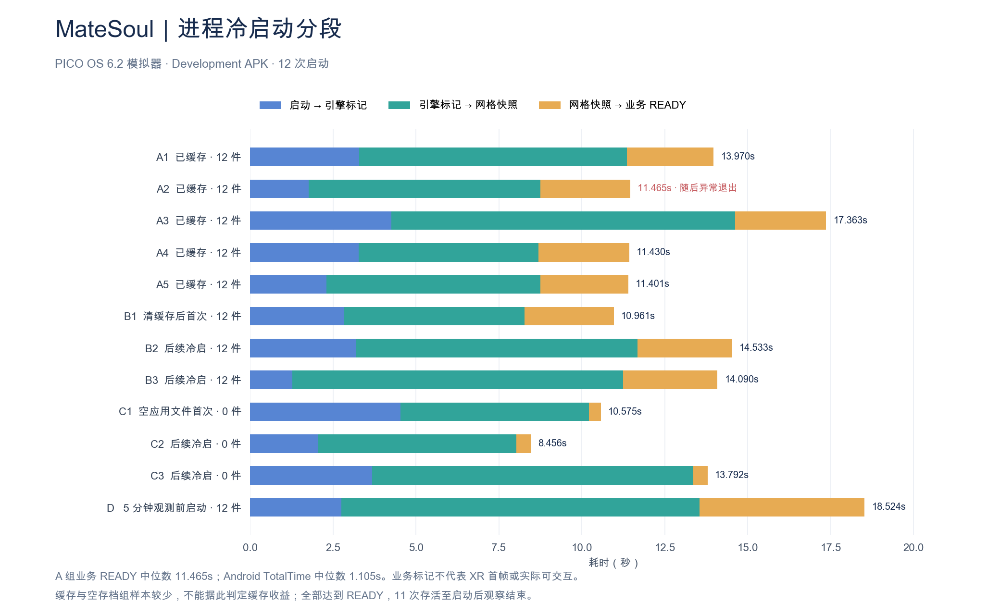
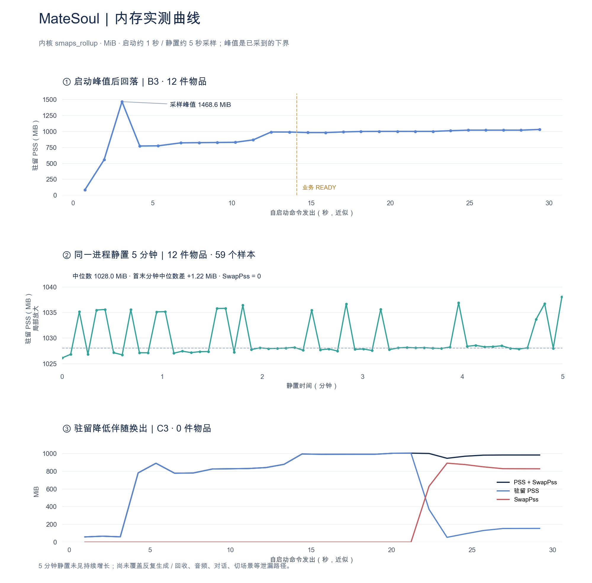

# MateSoul 冷启动、首次缓存与内存首轮实测

测量日期：2026-10-22；整理完成：2026-10-23。范围：12 次进程冷启动、应用文件缓存对照、同一进程约 5 分钟静置观察。本次未修改游戏源码。

**当前模拟器 Development 包的业务就绪时间约 11.5 秒，常驻内存约 1.0 GiB，启动采样峰值约 1.43 GiB。确认首次会生成并复用约 10.24 MiB 的 IL2CPP 文件，但没有测出明确的启动加速。5 分钟静置未见持续内存增长；另有一次到达业务就绪后异常退出，需优先追查。**

这些结果支持继续做启动优化和内存归因，尚不足以判断游戏不适合目标终端。当前只有模拟器连接，未取得目标真机 Release 包的启动、双眼渲染、动态环境深度及持续负载数据。

## 1. 环境与测量口径

| 项目 | 本轮实际环境 |
|---|---|
| 运行设备 | `emulator-5554`，PICO OS 6.2 模拟器 |
| Android | Android 16，`userdebug` |
| Unity / 构建 | Unity 2022.3.38f1，Development，ARM64 / IL2CPP |
| 图形环境 | 模拟器 Vulkan，日志报告 Apple M5；不能等同于终端 GPU |
| 宿主机内存 | 16 GiB；测量期间已有大量 Swap 使用 |
| APK | `Builds/MateSoul_Framework.apk`，182,880,466 字节，约 174.41 MiB |
| 安装包 SHA-256 | `146a7fcf7d765412b702f74aa34bfb12c72286b42d0a35b3f8e3c3385dea7501` |
| 场景 | 模拟器空间网格：48 块，地面面积 55.89 m²，86,323 个三角形 |
| 原存档 | 12 件物品：桌、收音机、刀、盘、锅体、锅铲、纸杯蛋糕、苹果各 1 件，苹果切块 4 件 |

每次先 `am force-stop` 并确认进程消失，再执行 `am start -W`。12 次均是进程重新创建的冷启动，**没有重启设备或清理操作系统页缓存、PICO 房间数据、系统权限及驱动缓存**。

计时采用三种不同口径：

- **Android TotalTime**：来自 `am start -W` / `Displayed`，反映 Activity 初始显示；它可能只是启动画面。
- **业务 READY**：从 `ActivityTaskManager START` 到 `MATESOUL_READY`，包括空间网格、导航、角色和存档物品恢复。源码在等待 `RestoreItemsAsync()` 后写出标记。
- **XR 首帧与实际可交互**：本轮没有测量。系统 `Fully drawn` 也可能早于业务 READY，不能代替这一指标。

内存优先读取 `/proc/<pid>/smaps_rollup`，启动及短暂稳定阶段约每秒采样，静置阶段约每 5 秒采样。采样和 ADB 本身会带来开销，短峰值可能被漏采。全程同时记录 **PSS、RSS、SwapPss**；本模拟器的 `dumpsys meminfo` 总计口径包含换出量等平台处理，不能直接与内核驻留 PSS 混用。

## 2. 冷启动结果

| 场景 | 次数 | 业务 READY 原始耗时，秒 | 中位数，秒 | 到达 READY / 存活至启动后观察结束 |
|---|---:|---|---:|---:|
| A：已有缓存，恢复 12 件物品 | 5 | 13.970 / 11.465 / 17.363 / 11.430 / 11.401 | **11.465** | 5 / 4 |
| B：清应用文件缓存，保留相同存档，首次启动 | 1 | 10.961 | 10.961 | 1 / 1 |
| B：上述首次启动后的再次进程冷启 | 2 | 14.533 / 14.090 | 14.312 | 2 / 2 |
| C：应用文件及偏好为空、无物品存档，首次启动 | 1 | 10.575 | 10.575 | 1 / 1 |
| C：上述首次启动后的再次进程冷启 | 2 | 8.456 / 13.792 | 11.124 | 2 / 2 |
| D：恢复 12 件物品，随后观察静置内存 | 1 | 18.524 | 18.524 | 1 / 1 |

短暂观察窗口：A 组 READY 后约 12 秒，B/C 约 15 秒，D 约 20 秒；D 随后还进行了约 5 分钟静置。这里的存活数量不代表完成交互验收。

A 组 Android TotalTime 中位数仅 **1.105 秒**，而业务 READY 中位数为 **11.465 秒**。只用 Android 初始显示耗时，会明显低估进入游戏的等待。A 组范围为 11.401–17.363 秒；D 单次达到 18.524 秒，说明当前环境抖动明显。每组样本很少，报告不将插值 P95 用作稳定性指标。

### 可确认的等待：旧锚点查询

A/B 组每次恢复存档，都出现 **6 次 `GetAllAnchor anchorTotal is 0`**。`PicoSpatialAnchorService.LoadAsync()` 最多查询 6 次，查询之间固定等待 400 ms，共 **5 × 400 ms = 2 秒**；未找到旧锚点后，`GameSession` 使用存档房间姿态恢复物品。

本轮 A/B 的“网格快照 → READY”为 **2.610–2.861 秒**，与这段查询等待相符。无物品存档 C 组没有该查询，网格快照后只用 **0.363–0.435 秒**达到 READY。D 同样进行了 6 次查询，但该段花了 4.971 秒，另有调度或处理开销尚未分解。

这是一处有源码和运行日志共同支持的优化候选。应在明确“锚点仍在定位”与“锚点已失效”的条件下改进启动流程，并保留有效锚点的正确恢复。**本轮走的是旧锚点缺失路径，不能直接把 2 秒当作所有真机启动的固定成本，也不建议据此直接删除重试。**

### 较大的未分解区间：引擎标记到网格快照

A 组该区间为 **5.421–10.362 秒**，中位数约 **6.986 秒**。它只说明启动耗时主要集中在网格快照之前；目前标记不够细，不能把整个区间归因于 PICO 服务、模型加载或 Shader 编译。

下一步应分别标记 Unity 场景加载、XR 初始化、空间数据 Provider 启动、首次有效网格查询、角色实例化等边界。NavMesh 构建实测仅 **24–33 ms**，当前不应优先优化。

源码依据：

- [业务 READY 写出位置](file:///Users/bytedance/MateSoul/MateSoul/Assets/MateSoul/Runtime/GameBootstrap.cs#L176-L186)
- [锚点查询和等待](file:///Users/bytedance/MateSoul/MateSoul/Assets/MateSoul/Runtime/SpatialAnchorService.cs#L68-L106)
- [锚点缺失后的存档姿态恢复](file:///Users/bytedance/MateSoul/MateSoul/Assets/MateSoul/Runtime/GameSession.cs#L670-L699)
- [模拟器有效网格快照标记](file:///Users/bytedance/MateSoul/MateSoul/Assets/MateSoul/RoomNavigation/Runtime/RoomMapProviders.cs#L295-L319)

## 3. 首次缓存结果

B 首次启动前，应用私有目录只保留 450 字节偏好，外部文件目录只有 12,621 字节存档。C 首次启动前，被测私有及外部文件目录为空；系统权限和设备侧空间数据仍然保留。**C 是“应用文件为空”的首次运行，不是卸载重装后包含授权流程的首次体验。**

| 首次产生的文件 | 字节数 | 作用与判断 |
|---|---:|---|
| `il2cpp/Metadata/global-metadata.dat` | 10,396,112 | IL2CPP 元数据文件 |
| `il2cpp/Resources/mscorlib.dll-resources.dat` | 337,563 | 运行时资源 |
| `il2cpp/unity.ver` | 36 | 运行时版本信息 |
| **IL2CPP 三项合计** | **10,733,711，约 10.24 MiB** | B/C 首次生成；后续启动大小及修改时间保持不变，确认文件复用 |
| `seating-validation/mesh.json` | 7,156,216，约 6.82 MiB | Development 探针导出的空间网格，不属于游戏加速缓存 |
| 两类探针 `state.json` | 合计约 21 KiB | 诊断状态输出，运行中会更新 |

第一次启动后，B 外部文件约 **17.09 MiB**，其中约 10.24 MiB 是 IL2CPP 文件、约 6.85 MiB 是诊断输出，另有存档。原有私有目录还存在约 33 KiB 的 ART 文件；清文件后未在这几次运行中重新出现。目录变化不能代表设备全部 Shader、ART 或 GPU 缓存的变化。

**本轮确认了缓存生成与复用，未确认启动性能收益。** B 首次为 10.961 秒，后续反而为 14.533 / 14.090 秒；C 首次为 10.575 秒，后续为 8.456 / 13.792 秒。样本少、宿主机内存压力大、测试顺序固定，不能从这种波动推出“缓存无效”或“缓存导致变慢”，也无法单独计算首次文件生成花了多少时间。

Release 测试应剔除现有 Development 探针的网格序列化、状态写盘和调试请求，再对相同场景交替执行“文件缓存清空 / 保留”的对照。

## 4. 内存结果

PSS 是共享页按比例分摊后的驻留占用；RSS 会完整计入共享页。SwapPss 是换出部分的分摊量。报告同时观察 `PSS + SwapPss`，用于识别“驻留下降但数据转入换出区”的情况；它不是完整 GPU 内存或实际物理 Swap 消耗。

| 指标 | 实测 |
|---|---:|
| 全轮应用驻留 PSS 采样峰值 | **1,468.58 MiB，约 1.43 GiB** |
| 该峰值所在轮次 | B3，约启动命令后 3 秒 |
| 同轮 RSS 采样峰值 | 1,623.46 MiB |
| A 组存活的 4 轮，稳定尾部 PSS 中位数 | 1,016.82 MiB |
| D 静置 5 分钟 PSS 中位数 | **1,028.05 MiB，约 1.00 GiB** |
| D 静置 PSS 范围 | 1,026.13–1,038.09 MiB |
| D 静置 RSS 中位数 | 1,194.04 MiB |
| D 静置 SwapPss | 全部样本为 0 |
| D 首分钟 / 末分钟 PSS 中位数 | 1,027.15 / 1,028.37 MiB |
| D 首末分钟中位数差 | **+1.22 MiB** |
| D PSS 线性拟合斜率 | +0.013 MiB/分钟 |
| D 进程及样本 | 同一 PID 12556，59 个样本，跨度 299.68 秒 |
| D 线程数 | 71–72 |

### 内存基线主要不是这 12 件已放置物品的增量

无物品存档的 C1/C2 稳定驻留 PSS 也约 **1,015–1,018 MiB**，与 12 件物品场景接近。这说明本轮测到的约 1 GiB 占用主要属于共同的常驻部分，不能仅通过减少已放置物品解决。可能涉及角色及资源、Unity 分配器、图形/XR 缓冲等，但本轮未取得可按 Unity 对象归因的快照。

代表性 A1 的 `dumpsys` 分类约为：Native Heap **72.7 MiB**、Unknown **811.8 MiB**、Dalvik Heap **1.3 MiB**。Unknown 较大，不能据此断言全是模型、贴图或泄漏；IL2CPP 下的 C# 分配也不能用 Java/Dalvik Heap 大小来判断。

内核映射分析同样看到大量匿名映射。其虚拟地址预留大小远高于实际驻留占用，应优先看 PSS/RSS，不能把虚拟预留量当成物理内存消耗。具体优化需要 Unity Memory Profiler 区分 Texture、Mesh、AnimationClip、AudioClip、Managed Heap、Native、Graphics 与 Reserved。

### C3 的驻留骤降来自换出

C3 稳定尾部中位数为：

| 驻留 PSS | SwapPss | 两者合计 |
|---:|---:|---:|
| 154.90 MiB | 827.84 MiB | **982.74 MiB** |

这是数据换出而非大规模资源释放，不能汇报为“内存优化到 155 MiB”。本轮观察到换出，但尚未确定其直接触发机制；继续验证时应保持应用前台，并同步记录进程状态、系统换出和内存压力。

### 对内存泄漏的判断仅限静置窗口

D 通过既有探针提交停留动作并关闭自主行为后观察，没有做反复生成、回收、切水果、保龄球、音频切换或 AI 对话压力测试。

这 5 分钟内没有持续、明显的增长，线程数也稳定；曲线中的周期性尖峰会回落。**可以认为本窗口没有发现持续泄漏迹象，不能判定游戏已通过泄漏测试。** 多次重启会释放整个进程，无法代替同一进程的循环操作测试。

此外，D 期间宿主机整个 QEMU 进程的 footprint 中位数约 **14.86 GiB**，它包含整台模拟器及相关宿主开销，不能算作游戏的 Android 内存占用。宿主机已有约 12 GiB Swap 使用，进一步限制了启动时间的可比性。客户系统的 `MemAvailable` 最低采样值约 2.55 GiB，也不足以排除所有原生、图形或系统异常。

## 5. 一次异常退出

**12 次均到达 READY，只有 11 次存活至启动后观察结束。A2 不计入稳定尾部内存统计。**

| A2 事件 | 设备单调时间，秒 |
|---|---:|
| 写出 `MATESOUL_READY items=12 itemState=ready` | 1524.586 |
| PICO `DumpUtils` 报告 `pre_display_error` 持续 7.5 秒，`error_prefix=LOADING` | 1524.679 |
| 开始收集 PID 7715 的栈 | 1524.684 |
| `ActivityManager` 报告该进程死亡 | 1524.716 |

进程在 READY 后约 **0.130 秒**退出。`ApplicationExitInfo` 记录 `reason=2 (SIGNALED)`、`status=3`，对应 **SIGQUIT**；本轮 crash buffer 为空。

PICO 的加载显示异常诊断、收栈和进程退出在时间上紧邻，值得优先定位，但还没有证明具体因果机制。当前证据**不能将它归类为 OOM，也不能据此断言所有应用必须在 7.5 秒内达到业务 READY**。应分别确认 XR 图层提交/显示状态、系统诊断触发条件和信号来源。

证据：[PICO 诊断及退出时间线](性能测试/20261022-233914/unexpected-exit-evidence.txt)、[系统退出原因](性能测试/20261022-233914/exit-info.txt)。

## 6. 建议的处理顺序

| 优先级 | 下一步 | 要解决的不确定性 |
|---|---|---|
| P0 | 定位 A2 的 PICO 加载显示异常与 SIGQUIT；补齐 XR 首帧、图层提交和系统诊断证据 | 业务 READY 后仍可能退出，先确认启动可靠性 |
| P1 | 在目标真机使用 Release 包复测；分别测空文件首次运行、已有缓存冷启、设备重启冷启，已有缓存至少 10 次 | 获取终端真实启动和内存基线，排除宿主压力及 Development 开销 |
| P1 | 分段记录 XR/空间数据初始化及 Unity 内容加载；单独对照有效锚点与失效锚点 | 分解网格快照前的大区间，判断何处可以并行或延后 |
| P1 | 同一运行阶段采集 Unity Memory Profiler 快照：空物品场景、12 件物品、主要内容加载后 | 解释约 1 GiB 常驻占用和约 1.43 GiB 启动峰值 |
| P2 | 同一进程跑 30–60 分钟交互循环，在每组相同恢复状态下比较快照 | 验证物品、音频、对话、网格和原生句柄是否残留 |

当前应把精力放在**启动可靠性、启动等待与常驻内存归因**。本轮没有证据支持优先重写 NavMesh、盲目增加缓存，或仅凭 Android 平台及 APK 大小判断必须更换游戏引擎。

## 7. 数据恢复与复核

测试前隔离并备份应用私有与外部数据。A/B 自动恢复遇到外部文件 FUSE 权限问题，随后通过重命名测试目录、恢复原目录完成修复；原始采集文件中的 `restored=false` 保留，后续成功恢复单独记录在 `recovery.json`。

重新启动前，恢复存档 SHA-256 与原值一致：

`5fb5e89e29f70e16784db0a453e2550c17be8974b9f49c81a7f14e5f0ce44f01`

最终复核时 ADB 已回到 `uid=2000(shell)`，游戏 PID 14304 仍运行，12 件物品的实例 ID、定义和房间锚点均保留。重新运行后的自动保存改变了部分物品姿态；整理报告跨过午夜，苹果库存也按 `RefreshDailyInventory()` 从 4 补到 5，日期从 10 月 22 日变为 23 日。因此最终运行中的存档哈希不同于启动前恢复哈希，已明确记录，未将其误报为恢复失败。

完整系统日志包含大量无关遥测，已移出交付目录；交付仅保留启动阶段标记、锚点空查询及退出证据。两份只有准备步骤的目录也已移出，保留以下两组实际采样。

## 8. 可复核数据

- [汇总 JSON](性能测试/20261022-233914/summary.json)
- [12 次启动与各轮内存 CSV](性能测试/20261022-233914/startup_results.csv)
- [内存时序 CSV](性能测试/20261022-233914/memory_samples.csv)
- [缓存文件清单 CSV](性能测试/20261022-233914/cache_inventory.csv)
- [A/B 原始采样及环境](性能测试/20261022-233914/measurements.json)、[精简启动证据](性能测试/20261022-233914/startup-and-runtime.log)
- [C/D 原始采样及环境](性能测试/20261022-234408/measurements.json)、[精简启动证据](性能测试/20261022-234408/startup-and-runtime.log)
- [代表性驻留内存](性能测试/20261022-233914/A-existing12-1-smaps_rollup.txt)、[静置结束驻留内存](性能测试/20261022-234408/D-idle12-end-smaps_rollup.txt)、[匿名映射分析](性能测试/20261022-233914/map-attribution.json)
- [A/B 恢复记录](性能测试/20261022-233914/recovery.json)、[环境恢复记录](性能测试/20261022-233914/final-environment-restoration.json)、[交付时复核](性能测试/20261022-233914/delivery-verification.json)
- [上一轮性能测试清单](MateSoul_PICO_Android_性能测试清单.md)

指标定义参考：[Android 启动时间](https://developer.android.com/topic/performance/vitals/launch-time)、[Android dumpsys 内存诊断](https://developer.android.com/tools/dumpsys#meminfo)。本报告的数值和发现来自上述本地实测与对应源码。
